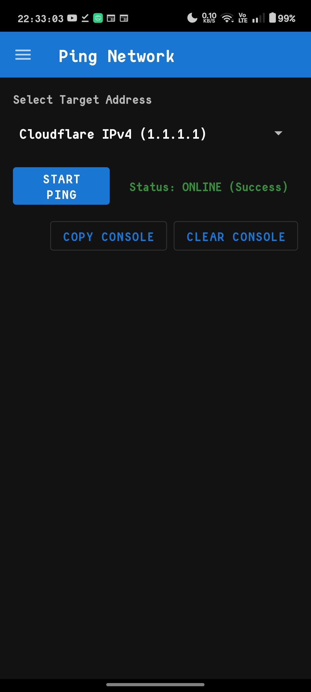
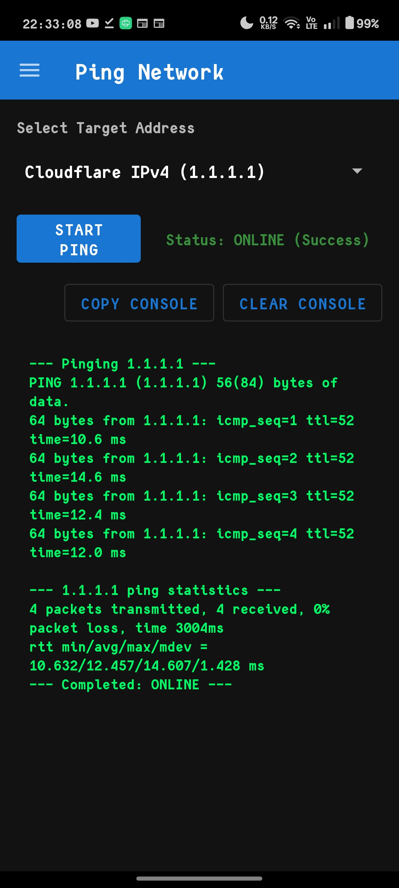
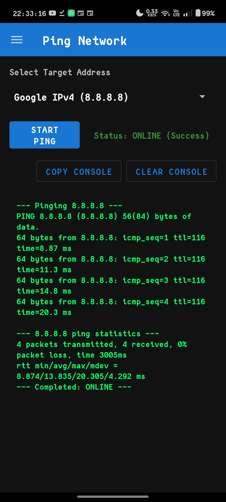
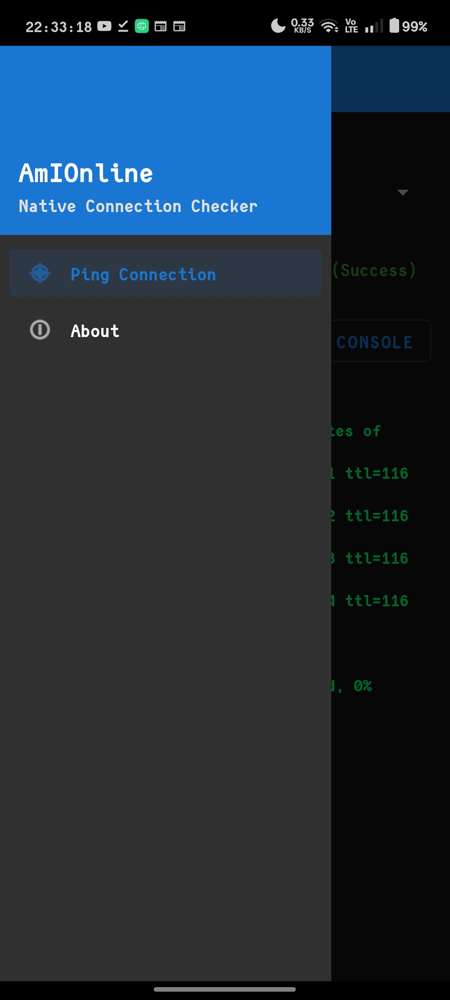
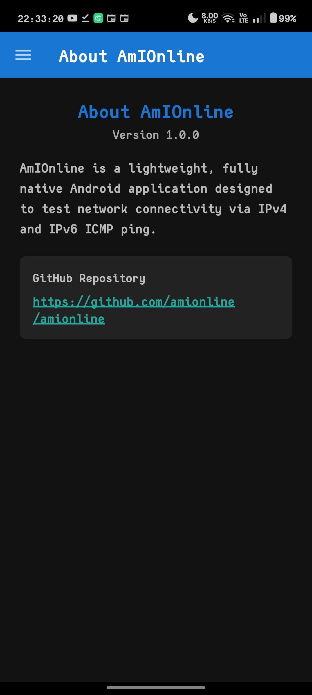
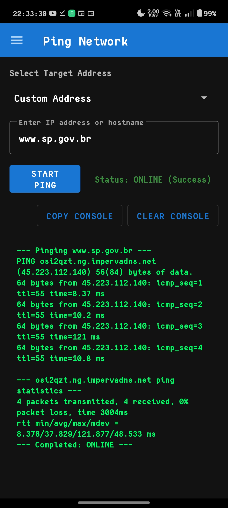
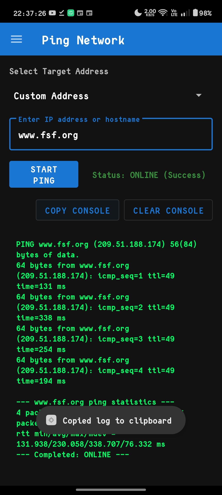

# AmIOnline

A lightweight Android app for checking whether a selected host or IP address responds to ICMP ping over Wi-Fi or Ethernet, with **continuous server monitoring**.















## Features

- **Manual ping**: one-off IPv4/IPv6 ping to Cloudflare, Google or a custom target (existing behaviour, unchanged).
- **Continuous monitoring**: periodically pings a user-selected server at a configurable interval (default 1 minute, minimum 10 seconds) and reports the status in a **persistent ongoing Android notification**:
  - Title: `ONLINE — 1.1.1.1`, `OFFLINE — 8.8.8.8`, `CHECKING — 1.1.1.1` or `ERROR — 1.1.1.1`
  - Body: `Total attempts: 120 | Successful: 118 | Server IP: 1.1.1.1`
- Notification actions: **Stop Monitoring** and **Open App**.
- Monitoring runs as a **foreground service**, so it keeps working when you leave the app or lock the screen (subject to Android battery optimizations).
- Counters (total / successful / failed attempts, last check time) are stored locally and survive restarts.

## Continuous monitoring — how it works

1. Pick a server (Cloudflare/Google IPv4/IPv6 presets or a custom address) and a check interval.
2. Tap **Start Monitoring**. The app resolves the address, starts a foreground service and shows the ongoing notification.
3. The service pings the target once per cycle (`ping -c 1`, so one cycle == one attempt — counting stays unambiguous) and updates the notification after every cycle.
4. Tap **Stop Monitoring** (in the app or from the notification) to stop the service and remove the notification.

### Counting rules

- **Total attempts**: probes actually executed (one per cycle).
- **Successful attempts**: probes that received at least one valid reply (parsed from real ping output, not guessed from the exit code).
- Failed probes increase total but not successful.
- DNS resolution failures and failures to start the `ping` process are reported as `ERROR` status but do **not** touch the counters — no probe was transmitted.
- Counters persist across restarts and are reset only via **Reset Statistics**.

### Interval

- Default: 60 seconds. Selectable presets from 15 seconds to 10 minutes, plus a custom value (minimum 10 seconds).
- Changes apply on the next check cycle — no app restart required.
- Android cannot guarantee exact timing: Doze, App Standby and battery restrictions may delay checks, especially for intervals under one minute. The app does not promise exact cadence and never shows `ONLINE` after a confirmed failed check.

### Permissions

- `INTERNET`, `ACCESS_NETWORK_STATE` — existing.
- `POST_NOTIFICATIONS` (Android 13+) — required to show the ongoing monitoring notification; requested at runtime when you start monitoring.
- `FOREGROUND_SERVICE` (Android 8+) and `FOREGROUND_SERVICE_DATA_SYNC` (Android 14+) — required to run the monitoring service in the foreground.

No data leaves the device: all pinging, statistics and storage are local. No backend, analytics or third-party SDKs.

## Build

```
./gradlew assembleDebug
./gradlew testDebugUnitTest
```

Requires the Android SDK (compileSdk 34, targetSdk 34, minSdk 24) and a JDK.

## Known limitations

- Exact sub-minute cadence cannot be guaranteed under Android battery optimizations (Doze/App Standby); the foreground service keeps monitoring as long as the system allows it.
- On very restricted device vendor builds, background execution may be more aggressive; the ongoing notification is the source of truth for whether monitoring is still active.

## What the result means

- **ONLINE** means the selected target answered at least one probe (a real reply line was parsed from the ping output).
- **OFFLINE** means the ping utility did not report a successful reply, or the target did not respond.
- A successful ping only proves that the selected target was reachable for that check. It does **not** guarantee that general Internet access, DNS, HTTPS, or other services are working.
- Some networks and hosts block ICMP. A host or service may still be available even when ping reports no reply.
- Hostnames are validated locally; DNS resolution happens when the system ping utility executes.
